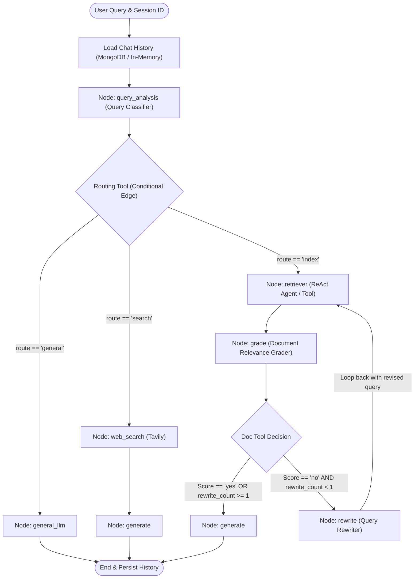

# Adaptive RAG - Agentic AI Chatbot

[](https://www.python.org/)
[](https://fastapi.tiangolo.com/)
[](https://python.langchain.com/langgraph/)
[](https://groq.com/)
[](https://github.com/facebookresearch/faiss)
[](https://ai.google.dev/)

---

## 📋 Overview

**Adaptive RAG** is an intelligent, end-to-end Retrieval-Augmented Generation (RAG) system powered by an agentic AI architecture. It overcomes the limitations of naive RAG by dynamically classifying incoming queries and routing them through specialized execution paths:

1. **Document Retrieval (Index)**: Searches uploaded customer documents using a ReAct agent, evaluates retrieved chunk relevance with an LLM grader, and rewrites queries if context is insufficient.
2. **General Knowledge**: Answers casual conversations or standard questions directly via LLM without unnecessary database retrieval.
3. **Real-time Web Search**: Leverages Tavily Search for questions requiring external, live, or missing knowledge.

Built using **LangGraph** for cycle-capable workflow orchestration, **Groq** for high-speed LLM reasoning, **Google Gemini** for high-fidelity text embeddings, **FAISS** for fast local vector retrieval, and **MongoDB** (with automatic in-memory fallback) for chat history management.

---

## 🎯 Key Features

### 🧠 Intelligent Query Routing
- **Adaptive Classification**: Evaluates user query and initial vector store context to choose the best path.
- **Three Routing Strategies**:
  - `index`: Answerable from user-uploaded documents (PDF / TXT).
  - `general`: Answerable using LLM internal knowledge or casual conversation.
  - `search`: Requires real-time internet information via Tavily Search.

### 📚 Self-Corrective RAG Pipeline
- **Document Ingestion**: Supports `.pdf` and `.txt` files with automatic chunking (`RecursiveCharacterTextSplitter`).
- **AI-Enhanced Descriptions**: User descriptions are refined by LLM into specialized tool instructions.
- **FAISS Vector Store**: Fast similarity search persisted locally to `faiss_index/` with Google Gemini embeddings (`models/gemini-embedding-001`).
- **ReAct Agent Retrieval**: LangChain ReAct agent reasons and calls the retriever tool, with automatic fallback to direct vector search.
- **Relevance Grading**: LLM grader evaluates whether retrieved context answers the question (`Grade` schema).
- **Self-Corrective Query Rewriting**: If retrieved context is not relevant, the system automatically rewrites the query and retries retrieval (safeguarded by max-retry limits to prevent infinite loops).

### 🤖 Agentic Architecture
- **LangGraph State Machine**: Deterministic and conditional transitions for reliable agent execution.
- **Structured Outputs**: Pydantic models (`RouteIdentifier`, `Grade`, `VerificationResult`) enforce strict type validation on LLM decisions.

### 💾 Resilient State & Session Management
- **MongoDB History**: Persistent multi-session conversation tracking using `motor` async client.
- **Graceful Fallback**: If MongoDB is unavailable or unconfigured, the system automatically falls back to in-memory session history without crashing.

### 🎨 Streamlit Web UI & FastAPI Backend
- **Streamlit Frontend**: Multi-page app with document upload, custom descriptions, and live chat.
- **RESTful FastAPI Backend**: Async endpoints for query execution and document indexing.

---

## 🏗️ Architecture & Workflow

### High-Level System Flow



### Graph Nodes Explained

| Node | Purpose | Details |
|------|---------|---------|
| `query_analysis` | Classifies query into `index`, `general`, or `search` | Samples vector store context; uses `RouteIdentifier` structured LLM output. |
| `retriever` | Retrieves matching document chunks | Uses LangChain ReAct agent with fallback to direct FAISS retriever. |
| `grade` | Evaluates retrieved chunk relevance | Returns `yes` or `no` via `Grade` structured LLM output. |
| `rewrite` | Optimizes query for retrieval | Rewrites user query if grading fails; increments `rewrite_count`. |
| `generate` | Formulates final user answer | Uses `generate_prompt` to synthesize clear responses from retrieved context. |
| `web_search` | Real-time web retrieval | Invokes Tavily search API and aggregates search snippets. |
| `general_llm` | Answers standard questions | Invokes Groq LLM directly with conversational context. |

---

## 📦 Project Structure

```
adaptive-rag/
├── src/                              # Main application source code
│   ├── main.py                       # FastAPI application entry point
│   ├── api/                          # REST API routes
│   │   └── routes.py                 # /rag/query and /rag/documents/upload endpoints
│   ├── config/                       # Configuration and prompt templates
│   │   ├── settings.py               # Prompt loader (prompts.yaml)
│   │   └── prompts.yaml              # Prompts for classification, grading, rewriting, generation
│   ├── core/                         # Core application configuration
│   │   ├── config.py                 # Environment variables and Settings class
│   │   └── logger.py                 # Application logger setup
│   ├── db/                           # Database connection
│   │   └── mongo_client.py           # Async MongoDB client (motor)
│   ├── llms/                         # LLM provider integrations
│   │   └── groq.py                   # Groq ChatGroq LLM initialization
│   ├── memory/                       # Chat conversation history
│   │   ├── chat_history_mongo.py     # MongoDB-backed chat history
│   │   └── chathistory_in_memory.py  # In-memory history fallback
│   ├── models/                       # Pydantic schemas and state
│   │   ├── state.py                  # LangGraph State TypedDict definition
│   │   ├── query_request.py          # API request schema (query, session_id)
│   │   ├── route_identifier.py       # Pydantic schema for query routing
│   │   ├── grade.py                  # Pydantic schema for document relevance grading
│   │   └── verification_result.py    # Answer faithfulness schema
│   ├── rag/                          # RAG pipeline implementation
│   │   ├── graph_builder.py          # LangGraph graph definition and node logic
│   │   ├── retriever_setup.py        # FAISS vector store and Gemini embeddings
│   │   ├── document_upload.py        # Document parsing, chunking, and indexing
│   │   ├── reAct_agent.py            # ReAct agent setup for retrieval
│   │   └── nodes.py                  # Node definitions
│   └── tools/                        # Helper tools
│       ├── common_tools.py           # LLM description enhancer
│       └── graph_tools.py            # Conditional routing tools (routing_tool, doc_tool)
│
├── streamlit_app/                    # Streamlit web user interface
│   ├── home.py                       # Landing page and session initialization
│   ├── pages/                        # Multi-page views
│   │   └── chat.py                   # Main chat view with sidebar document upload
│   └── utils/                        # Frontend utilities
│       └── api_client.py             # HTTP client communicating with FastAPI backend
│
├── faiss_index/                      # Persisted local FAISS index files (index.faiss, index.pkl)
├── requirements.txt                  # Python package dependencies
├── DOCUMENT_FLOW_VISUAL.md           # Step-by-step document lifecycle guide
├── DOCUMENT_UPLOAD_FLOW.md           # Detailed upload sequence documentation
└── README.md                         # Project documentation
```

---

## 🔌 API Endpoints

### Base URL
```
http://localhost:8000
```

### 1. Process Query
**`POST /rag/query`**

Executes the Adaptive RAG graph for a given query and session.

**Request Body:**
```json
{
  "query": "What are the key findings mentioned in the document?",
  "session_id": "session_user_001"
}
```

**Response:**
```json
{
  "result": {
    "content": "Based on the document, the key findings are...",
    "additional_kwargs": {},
    "response_metadata": {},
    "type": "ai"
  }
}
```

---

### 2. Upload Document
**`POST /rag/documents/upload`**

Uploads and indexes a PDF or TXT document into the FAISS vector store.

**Headers:**
- `X-Description` *(string, required)*: Brief description of the document topic.

**Form Data:**
- `file`: Document file (`.pdf` or `.txt`).

**Response:**
```json
{
  "status": true
}
```

---

## 📖 Getting Started

### 1. Prerequisites
- **Python**: 3.9+ (Python 3.12 recommended)
- **Groq API Key**: For LLM inference ([console.groq.com](https://console.groq.com))
- **Google Gemini API Key**: For text embeddings ([aistudio.google.com](https://aistudio.google.com))
- **Tavily API Key**: For web search ([tavily.com](https://tavily.com))
- **MongoDB** *(Optional)*: Local or MongoDB Atlas (falls back to in-memory history if absent)

---

### 2. Installation

```bash
# 1. Clone the repository
git clone https://github.com/simplyhemant/adaptive-rag.git
cd adaptive-rag

# 2. Create and activate a virtual environment
python3 -m venv venv
source venv/bin/activate  # On Windows: venv\Scripts\activate

# 3. Install required dependencies
pip install -r requirements.txt
```

---

### 3. Environment Configuration

Create a `.env` file in the root directory:

```env
# Groq LLM Configuration (Primary LLM)
GROQ_API_KEY=your_groq_api_key_here
GROQ_MODEL=openai/gpt-oss-20b

# Google Configuration (Embeddings)
GOOGLE_API_KEY=your_google_api_key_here
GEMINI_API_KEY=your_google_api_key_here
GEMINI_MODEL=gemini-2.5-flash-lite
GEMINI_EMBEDDING_MODEL=models/gemini-embedding-001

# Tavily Search Configuration
TAVILY_API_KEY=your_tavily_api_key_here

# MongoDB Configuration (Optional - in-memory fallback is automatic)
MONGODB_URL=mongodb://localhost:27017
MONGODB_DB_NAME=adaptive_rag

# Optional: LangSmith Tracing
LANGSMITH_TRACING=false
# LANGSMITH_API_KEY=your_langsmith_api_key
# LANGSMITH_PROJECT=adaptive-rag
```

---

### 4. Running the Application

Open two terminal sessions:

#### Terminal 1: Start FastAPI Backend
```bash
uvicorn src.main:app --reload --host 0.0.0.0 --port 8000
```
*API interactive documentation will be available at: http://localhost:8000/docs*

#### Terminal 2: Start Streamlit Frontend
```bash
streamlit run streamlit_app/home.py
```
*Web user interface will open at: http://localhost:8501*

---

## 🧪 Testing the Pipeline

### Example 1: Upload a Document via cURL
```bash
curl -X POST http://localhost:8000/rag/documents/upload \
  -H "X-Description: Python programming guide and syntax tutorial" \
  -F "file=@sample_guide.pdf"
```

### Example 2: Ask an Index Question
```bash
curl -X POST http://localhost:8000/rag/query \
  -H "Content-Type: application/json" \
  -d '{
    "query": "What does the guide say about list comprehensions?",
    "session_id": "demo_session_1"
  }'
```

### Example 3: Ask a Real-Time Search Question
```bash
curl -X POST http://localhost:8000/rag/query \
  -H "Content-Type: application/json" \
  -d '{
    "query": "What were the latest major tech news headlines today?",
    "session_id": "demo_session_1"
  }'
```

### Example 4: Ask a General Knowledge Question
```bash
curl -X POST http://localhost:8000/rag/query \
  -H "Content-Type: application/json" \
  -d '{
    "query": "Explain what bubble sort is in simple terms.",
    "session_id": "demo_session_1"
  }'
```

---

## 📚 Technology Stack

| Layer | Component | Version / Provider | Description |
|---|---|---|---|
| **Orchestration** | LangGraph | `~0.5.4` | Cyclic state graph workflow with conditional edges |
| **LLM Engine** | ChatGroq | `langchain-groq ~0.3.8` | Ultra-fast inference (`openai/gpt-oss-20b`) |
| **Embeddings** | Google Gemini | `langchain-google-genai ~2.1.12` | Dense vector embeddings (`models/gemini-embedding-001`) |
| **Vector Database** | FAISS | `faiss-cpu` | High-performance similarity search saved to `faiss_index/` |
| **Search Engine** | Tavily | `tavily-python` | Real-time web retrieval tool |
| **Backend** | FastAPI / Uvicorn | `fastapi ~0.115.14` | High-throughput asynchronous REST API |
| **Frontend** | Streamlit | Latest | Clean chat and upload interface |
| **Chat Memory** | MongoDB / Motor | `motor`, `pymongo` | Multi-turn chat persistence with in-memory fallback |
| **Document Loaders**| PyPDF / TextLoader | `pypdf`, `beautifulsoup4` | PDF and text document ingestion |
| **Validation** | Pydantic | `~2.11.7` | Type safety and structured LLM tool outputs |

---

## ❓ FAQ

**Q: Where are uploaded documents stored?**  
A: Uploaded documents are chunked and converted into vector embeddings, which are stored locally in the `faiss_index/` directory.

**Q: What happens if MongoDB is not running?**  
A: The system automatically catches connection failures and switches to an in-memory chat session history (`ChatInMemoryHistory`), so the application runs without interruption.

**Q: What happens if the retriever finds irrelevant chunks?**  
A: The `grade` node scores the chunks. If they are irrelevant, the `rewrite` node optimizes the query and retries retrieval. A retry counter prevents infinite loops.

**Q: Can I change the LLM model?**  
A: Yes! You can change `GROQ_MODEL` in your `.env` file (e.g. `llama-3.3-70b-versatile` or `mixtral-8x7b-32768`), or adjust settings in [src/core/config.py](file:///home/hemant/Desktop/adaptive-rag/src/core/config.py) and [src/llms/groq.py](file:///home/hemant/Desktop/adaptive-rag/src/llms/groq.py).

---

